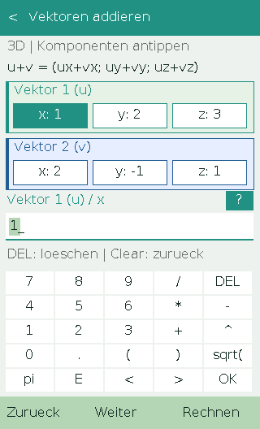
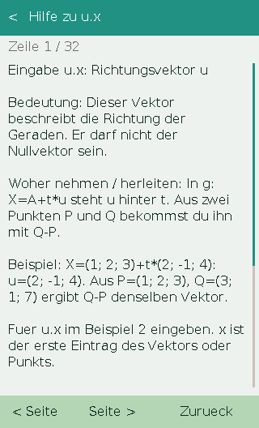

# Mathe Vektor für den Casio ClassPad II

**Vektorrechnung und analytische Geometrie für Schule und Abitur – mit Rechenwegen, Formeln, Beispielen und Eingabehilfe.**

Mathe Vektor bietet **46 Rechenfunktionen** für den Casio ClassPad II / fx-CP400.
Die App läuft als `.hh3`-Datei über Hollyhock 3 und lässt sich mit Touchscreen
und Tasten bedienen. Alle Inhalte sind direkt in der App enthalten und offline verfügbar.

## Download

**[Aktuelle Version herunterladen](https://github.com/Loewenkrieger/Casio-Classpad-2-CP400-Mathe-App/releases/latest)**

| Datei | Inhalt |
| --- | --- |
| [mathe_classpad_v1_0_3.zip](https://github.com/Loewenkrieger/Casio-Classpad-2-CP400-Mathe-App/releases/download/v1.0.3/mathe_classpad_v1_0_3.zip) | Fertige App mit Installationsanleitung und Lizenzen |
| [mathe.hh3](https://github.com/Loewenkrieger/Casio-Classpad-2-CP400-Mathe-App/releases/download/v1.0.3/mathe.hh3) | Einzelne App-Datei, direkt auf den ClassPad kopierbar |
| [mathe_source_v1_0_3.zip](https://github.com/Loewenkrieger/Casio-Classpad-2-CP400-Mathe-App/releases/download/v1.0.3/mathe_source_v1_0_3.zip) | Vollständiger Quellcode mit benötigten SDK-Dateien |
| [SHA256SUMS.txt](https://github.com/Loewenkrieger/Casio-Classpad-2-CP400-Mathe-App/releases/download/v1.0.3/SHA256SUMS.txt) | Prüfsummen der Downloads |

## Voraussetzungen und Installation

Benötigt wird ein **Casio ClassPad II / fx-CP400 mit Hollyhock 3**, einem Launcher
für `.hh3`-Apps und **OS 02.01.7002.0001**.

1. Das fertige App-ZIP aus dem Release herunterladen und entpacken.
2. Den ClassPad per USB verbinden und das Taschenrechner-Laufwerk öffnen.
3. **`mathe.hh3` ins Hauptverzeichnis neben die vorhandene `run.bin` kopieren.**
4. Das Laufwerk sicher auswerfen und USB trennen.
5. Hollyhock 3 öffnen, **Mathe Vektor** auswählen und starten.

Auf dem Taschenrechner wird nur `mathe.hh3` benötigt. Für ein Update diese Datei
durch die neue Version ersetzen.

Informationen zur Einrichtung der Startumgebung:
[Hollyhock 3](https://classpad.dev/wiki/hh3/getting-started/install/) ·
[Hollyhock 3 Custom Launcher](https://github.com/Loewenkrieger/Hollyhock-3-Custom-Launcher)

## So sieht die App aus

  
  

## Was lässt sich berechnen?

| Bereich | Funktionen |
| --- | --- |
| **Vektoren** | Addition, Subtraktion, Multiplikation mit einem Skalar, Betrag, Einheitsvektor, Skalarprodukt, Kreuzprodukt, Spatprodukt, Determinante und Winkel; Parallelität und Orthogonalität prüfen |
| **Punkte** | Verbindungsvektor, Mittelpunkt, innere und äußere Teilung; Kollinearität und Koplanarität prüfen; Punkt im Dreieck untersuchen |
| **Geraden und Ebenen aufstellen** | Gerade durch zwei Punkte, Ebene durch drei Punkte; Parameter-, Koordinaten-, Normalen- und Hessesche Normalenform |
| **Lage, Schnitt und Abstand** | Punkt–Punkt, Punkt–Gerade, Punkt–Ebene, Gerade–Gerade, Gerade–Ebene und Ebene–Ebene; Schnittpunkte, Schnittgeraden, Schnittwinkel und Abstände |
| **Projektion und Spiegelung** | Vektorprojektion, orthogonale Zerlegung, Lotfußpunkte und Punktspiegelungen an Geraden und Ebenen |
| **Flächen und Volumen** | Dreiecksfläche, Seiten, Winkel, Umfang, Höhe auf AB und Schwerpunkt; Parallelogrammfläche, Spatvolumen und -höhe sowie Tetraedervolumen |
| **Kugeln** | Punktprobe, Abstand zur Oberfläche und zum Kugelkörper, Oberfläche und Volumen; Gerade–Kugel, Ebene–Kugel und Kugel–Kugel; Kugel durch vier Punkte |
| **Parameteraufgaben** | Parameter für parallele oder orthogonale affine Vektoren und vorgegebene Längen; affiner Punkt auf einer Geraden oder in einer Ebene; Koplanarität mit einem affinen Punkt |
| **Gleichungssysteme und lineare Algebra** | 2×2-, 3×3- und 4×4-LGS, Linearkombinationen sowie lineare Unabhängigkeit und Basiseigenschaft dreier Vektoren im ℝ³ |

Die App unterscheidet unter anderem zwischen identischen, parallelen und
windschiefen Geraden, Tangenten und Sekanten sowie eindeutigen, fehlenden und
unendlich vielen Lösungen von Gleichungssystemen.

Zu den Aufgaben gehören **Rechenwege, passende Formeln, Erklärungen und
durchgerechnete Beispiele**.

## Bedienung

- **Auswählen:** Eintrag antippen oder mit den Pfeiltasten markieren und mit EXE öffnen.
- **Werte eingeben:** x, y oder z im passenden Vektorblock antippen. Vektor 1 ist grün, Vektor 2 blau; das aktive Feld ist hervorgehoben.
- **Weitere Blöcke:** Oben mit `<` und `>` blättern. EXE führt automatisch zum nächsten Feld und Block.
- **Eingabehilfe:** Das **`?` neben dem aktiven Feld** erklärt dessen Bedeutung, Herkunft beziehungsweise Herleitung und ein Zahlenbeispiel. Zurück oder Clear erhält die bisherigen Eingaben.
- **Bearbeiten:** Die erste Eingabe ersetzt den markierten Vorgabewert. DEL löscht; Pfeile und EXE wechseln nach gültiger Eingabe das Feld.
- **Rechnen:** `Rechnen`, `=` oder EXE im letzten Feld startet die Berechnung.
- **Rechenweg lesen:** Mit Pfeilen, den Seitentasten unten oder durch Ziehen scrollen.
- **Zurück und beenden:** Clear geht eine Ansicht zurück. Auf dem Startbildschirm beendet Clear die App direkt und führt zum Launcher.
- **2D und 3D:** Unter Einstellungen für geeignete Vektor- und Punktaufgaben wählen. In 2D wird z auf 0 gesetzt; räumliche Geraden-, Ebenen- und Kugelaufgaben verwenden 3D.

## Zahlen und Gleichungen eingeben

Erlaubt sind Dezimalpunkt oder Dezimalkomma, `+ - * / ^`, Klammern, `sqrt(...)`,
`pi` und `E` für Zehnerpotenzen. Beispiele: **`1/3`**, **`sqrt(2)`**,
**`(2+3)/4`** und **`1E-3`**. Multiplikationen mit `*` schreiben.

- **Gerade:** `X=A+t*u`. A ist der Stützpunkt, u der Richtungsvektor.
- **Ebene:** `n.X=d`. Bei `2x-y+3z-6=0` also `n=(2; -1; 3)` und `d=6` eingeben.
- **Parameterfamilie:** `u(t)=u0+t*u1`. Aus `u(t)=(1+t; 2-3t; 4)` werden `u0=(1; 2; 4)` und `u1=(1; -3; 0)`.

Die Ergebnisse werden auf **zehn signifikante Stellen** gerundet. Brüche und
Wurzeln werden numerisch ausgewertet. Eingabewerte sind **0 oder Zahlen mit
einem Betrag zwischen 10⁻¹² und 10¹²**. Bei sehr unterschiedlichen Größenordnungen
hilft eine einheitliche Skalierung der Werte.

## Lizenz und Quellen

Mathe Vektor steht unter der [GPL-3.0-or-later](LICENSE).
Das [Hollyhock-3-SDK](https://github.com/ClasspadDev/hollyhock-3) und die
[DejaVu-Schrift](docs/FONT-LICENSE.txt) werden unter ihren jeweiligen Lizenzen verwendet.
Das Bedienkonzept orientiert sich an der
[Physik-App für den ClassPad II](https://github.com/Loewenkrieger/Casio-Classpad-2-CP400-Physik-App).

Ein Community-Projekt von Loewenkrieger für den Casio ClassPad II.
